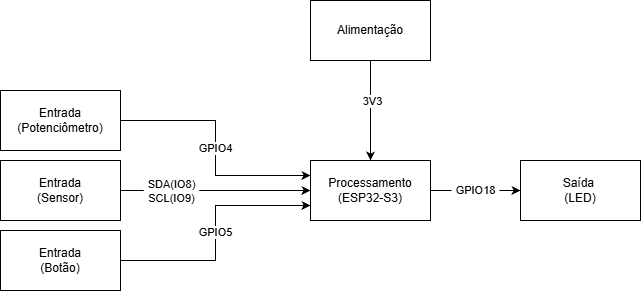
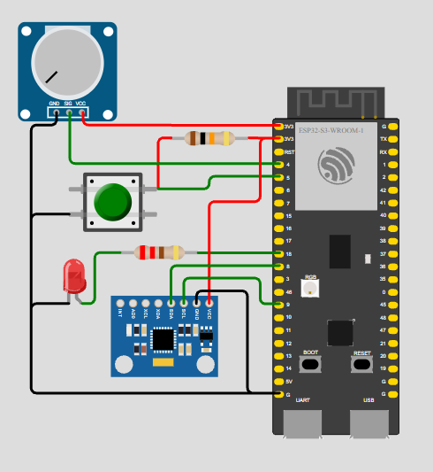

# Atividade 10

## Diagrama de Blocos

Ferramenta utilizada: [Draw.io](https://app.diagrams.net/)

## Simulação e Código

[Link para Simulação com Código no WOLKI](https://wokwi.com/projects/478589952222379009)

Ferramenta Utilizada: [WOLKI](https://wokwi.com/)

